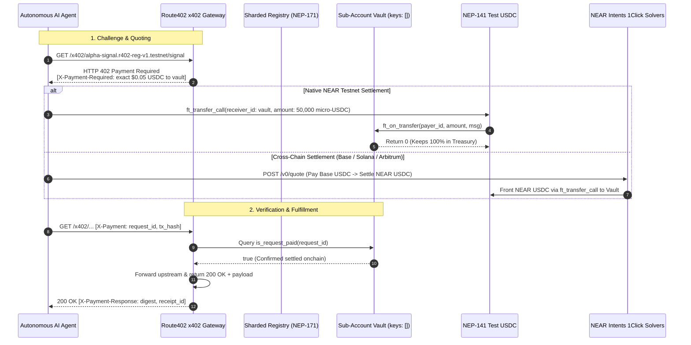
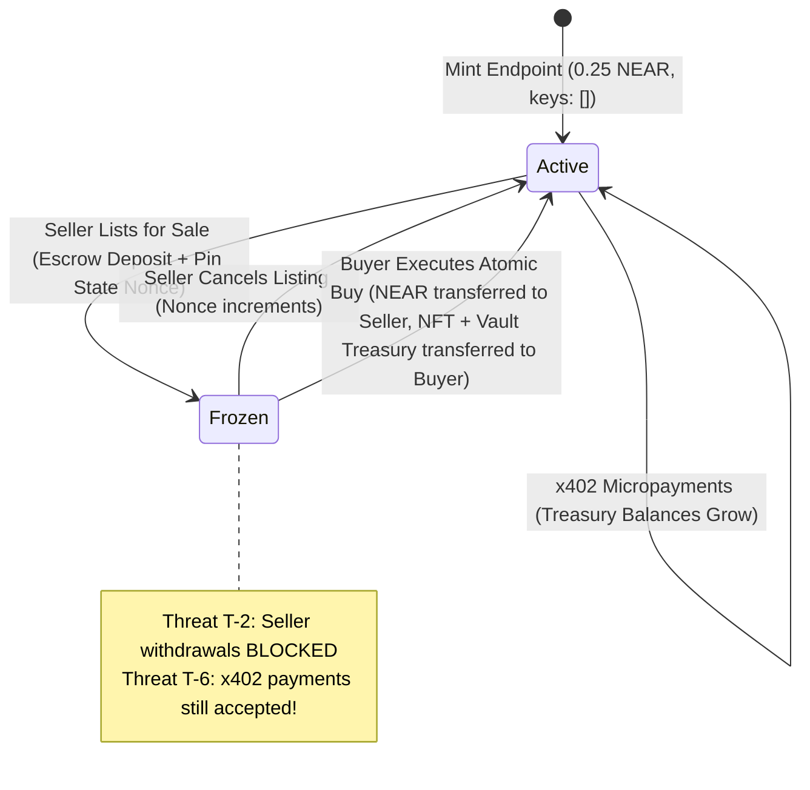

<div align="center">

# 🌐 Route402

### Cash-Flowing `x402` API & MCP Endpoints as Sharded NEAR Account-NFTs: NEP-591 Global Contracts, HTTP 402 Micro-Payments, House of Stake `sharded-item-1.0.0`, and NEAR Intents 1Click Cross-Chain Settlement.

[](https://testnet.nearblocks.io/address/r402-reg-v1.testnet)
[](#tests-and-checks)
[](#pillar-1-keyless-sharded-account-nfts--nep-591-global-contracts)
[](#pillar-2-http-402-x402-reverse-proxy--in-vault-treasury)
[](#pillar-3-near-intents-1click-multi-chain-settlement)
[](#pillar-5-agent-mcp-server--autonomous-machine-consumers)
[](LICENSE)

Route402 eliminates the **AI Agent Payment Dilemma** and the **Illiquid API Asset Trap**. Past API monetization models forced autonomous AI agents to use human-gated credit cards or monthly SaaS subscription lock-ins, while API developers had no standard way to tokenize, collateralize, or sell their cash-flowing endpoints without transferring AWS accounts or Stripe credentials. Route402 enables developers to mint monetized APIs and Model Context Protocol (MCP) tools as **sovereign, keyless sub-account NFTs on NEAR** that receive per-query micro-payments directly from AI agents across **NEAR, Base, Solana, Arbitrum, and Ethereum**, and can be traded atomically in escrow with verified 6-vector threat protection.

**Mint sovereign. Monetize per-call via HTTP 402. Trade cash-flowing API sub-accounts atomically.**

[🚀 Live Testnet Registry](https://testnet.nearblocks.io/address/r402-reg-v1.testnet) · [⚡ Live Web Console](#4-launch-interactive-web-console--x402-gateway) · [📖 Quick Verification for Judges](#quick-verification-for-judges-do-x---see-y) · [Explore Without a Wallet](#explore-without-a-wallet) · [Formal Threat Model](#formal-threat-model-matrix-t-1--t-6)

**Sovereign Agent Economy — Keyless Sub-Account Treasuries, Immutable Global Contracts, and 1Click Intent Settlement.**

NEAR Protocol · NEP-591 Global Contracts · Rust Smart Contracts · TypeScript · React 19 · Vite · Model Context Protocol (MCP) · NEAR Intents (Defuse 1Click) · NEP-141 USDC

</div>

> **Cryptographic and economic integrity system.** Route402 strictly enforces keyless Tier-2 (`T2`) pair verification and NEP-591 Global Contracts. Sub-accounts are created with 0 access keys (`keys: []`) and deployed via immutable code hash on NEAR Testnet (`0.25 NEAR` per mint instead of `~2 NEAR`). All revenue settles directly into the sub-account's self-custodial treasury via NEP-141 `ft_transfer_call`. Selling an endpoint locks the vault in `Frozen` escrow: buyer funds and endpoint ownership swap atomically, seller mid-sale drains are blocked onchain (`Threat T-2`), and ongoing caller payments are preserved in treasury (`Threat T-6`).

---

## Explore without a wallet

| Open / Action | Look for | What it establishes |
| :--- | :--- | :--- |
| [🔗 Testnet Registry Contract](https://testnet.nearblocks.io/address/r402-reg-v1.testnet) | `r402-reg-v1.testnet` on Nearblocks | Genesis sharded collection registry managing NEP-171/177 tokens and atomic marketplace escrow |
| [🔗 Testnet NEP-141 USDC](https://testnet.nearblocks.io/address/r402-usdc-v1.testnet) | `r402-usdc-v1.testnet` | 6-decimal Test USDC token used for onchain HTTP 402 micro-settlements |
| [🔗 Proof Tx: Seller Drain Blocked](https://testnet.nearblocks.io/txns/4y4gSjQpXx8kuj7kqcobkW6dWe16NK5eAc6jKLCdejbs) | `4y4gSj...dejbs` (Panic: `Vault is Frozen`) | Cryptographic proof that seller mid-sale drain attempts are rejected onchain ([Threat T-2](#formal-threat-model-matrix-t-1--t-6)) |
| [🔗 Proof Tx: Mid-Sale Settlement](https://testnet.nearblocks.io/txns/2sct1tUAS16xTdbxeSgUzzHHDu9D9eq4ex65kCrwQJX8) | `2sct1t...wQJX8` (`80,000` micro-USDC) | Cryptographic proof that live x402 revenue settles into a `Frozen` vault during an escrow listing ([Threat T-6](#formal-threat-model-matrix-t-1--t-6)) |
| [💻 `npm run verify:testnet`](#2-verify-live-deployed-contracts-on-near-testnet-zero-keys-required) | Zero-key CLI verification output | Queries live NEAR Testnet RPC, verifying finalized `T2` sharded pair proofs and `keys: []` zero-key guarantees |
| [⚡ `npm run demo -- --once`](#3-run-the-end-to-end-judge-walkthrough-simulated--live-dry-quote-modes) | Unified E2E walkthrough | Boots gateway, discovers endpoints, executes autonomous 402 payment, tests blocked drain, and simulates atomic buyout |
| [🖥️ `http://127.0.0.1:4173`](#4-launch-interactive-web-console--x402-gateway) | Route402 Sovereign Console | Full luxury editorial interface with real-time telemetry, live charts, NEAR wallet connector, and sandbox/testnet switcher |

---

## Contents

- [Why Route402 exists](#why-route402-exists)
- [Who is it for?](#who-is-it-for)
- [How it works](#how-it-works)
- [The 3-Sided Market](#the-3-sided-market)
- [6-Pillar core architectural subsystems](#6-pillar-core-architectural-subsystems)
  - [Pillar 1: Keyless Sharded Account-NFTs & NEP-591 Global Contracts](#pillar-1-keyless-sharded-account-nfts--nep-591-global-contracts)
  - [Pillar 2: HTTP 402 (`x402`) Reverse Proxy & In-Vault Treasury](#pillar-2-http-402-x402-reverse-proxy--in-vault-treasury)
  - [Pillar 3: NEAR Intents 1Click Multi-Chain Settlement](#pillar-3-near-intents-1click-multi-chain-settlement)
  - [Pillar 4: Atomic Escrow & 6-Vector Transfer Threat Mitigation](#pillar-4-atomic-escrow--6-vector-transfer-threat-mitigation)
  - [Pillar 5: Agent MCP Server & Autonomous Machine Consumers](#pillar-5-agent-mcp-server--autonomous-machine-consumers)
  - [Pillar 6: Luxury Editorial Console & Real-Time Telemetry](#pillar-6-luxury-editorial-console--real-time-telemetry)
- [Live NEAR Testnet deployment & onchain proofs](#live-near-testnet-deployment--onchain-proofs)
- [Formal Threat Model Matrix (`T-1` .. `T-6`)](#formal-threat-model-matrix-t-1--t-6)
- [System interface & API codecs](#system-interface--api-codecs)
- [Honest Runtime Mode Matrix](#honest-runtime-mode-matrix)
- [Performance & full-stack optimizations](#performance--full-stack-optimizations)
- [Run locally & quick verification](#run-locally--quick-verification)
- [Engineering decisions](#engineering-decisions)
- [Technology](#technology)
- [Repository map](#repository-map)
- [Trust boundaries and limitations](#trust-boundaries-and-limitations)
- [Official documentation & references](#official-documentation--references)

---

## Why Route402 exists

Traditional API monetization and Web3 asset models suffer from three structural breakdowns:

1. **The AI Agent Payment Dilemma**: Autonomous software agents (running Claude, LangChain, AutoGen, or Cursor) cannot open bank accounts, sign multi-month credit card subscriptions, or pass Stripe merchant KYC. They need instant, trustless, pay-per-query settlement.
2. **The High-Friction API Monetization Trap**: Independent developers building high-value APIs (DeFi oracles, specialized LLMs, confidential TEE computation) spend days setting up Stripe billing, API key auth tables, rate-limiters, and merchant bank compliance, with high percentage fees and global geographic exclusions.
3. **The Illiquid API Asset Problem**: Successful APIs generate reliable cash flows, but selling an API business traditionally requires escrow attorneys, company equity transfers, and precarious AWS/Stripe credential handovers. The buyer has zero cryptographic guarantee that the seller hasn't retained root API keys or drain scripts.

| Dimension | Web2 APIs (Stripe / RapidAPI) | Standard NFTs (ERC-721 / Vanilla NEP-171) | Route402 Sovereign Account-NFTs |
| :--- | :--- | :--- | :--- |
| **Payment Unit** | Monthly recurring subscriptions or credit card tranches | Static metadata image / pointer | Pay-per-call micro-USDC (`$0.01` – `$0.10`) via HTTP 402 |
| **Machine Accessibility** | Blocked by CAPTCHAs, KYC, & credit cards | Non-functional for automated API queries | 100% native machine integration via MCP & HTTP 402 |
| **Treasury Custody** | Centralized in Stripe / merchant bank account | None (NFT owns no funds) | Self-custodial in keyless sub-account (`keys: []`) |
| **Asset Transferability** | Painful manual company asset sale | Transferable, but yields no revenue | Atomic transfer of live revenue stream + treasury |
| **Cross-Chain Access** | Single fiat currency rail | Single chain silo | Multi-chain: Base, Solana, Arbitrum, Ethereum, NEAR |
| **Minting Overhead** | High SaaS setup & monthly fees | Full contract deploy (~`2 NEAR` per contract) | NEP-591 Global Contract: **`0.25 NEAR`** total mint cost |

---

## Who is it for?

Route402 is purpose-built for three key stakeholders in the autonomous internet economy:

### 1. Autonomous AI Agents (The Pay-Per-Query Consumers)
- **Who they are:** Autonomous agent workflows running on LangChain, AutoGen, CrewAI, Claude Desktop (MCP), Cursor, OpenAI Swarm, or autonomous trading bots.
- **Their Problem:** AI agents cannot open bank accounts, hold credit cards, pass CAPTCHAs, or commit to monthly recurring SaaS subscriptions. They need frictionless, machine-to-machine, pay-per-call micro-settlement.
- **How Route402 Serves Them:**
  - **Automated 402 Negotiation:** When an agent receives an `HTTP 402 Payment Required` header, the agent pays the exact sub-cent cost (e.g. `$0.05 USDC`) and immediately unlocks the payload.
  - **Cross-Chain Native via 1Click:** Through **NEAR Intents 1Click**, agents can pay from their existing balances on **Base, Solana, Arbitrum, or Ethereum**. Solvers front the NEAR USDC in ~4 seconds with zero bridge risk for the caller.
  - **Native MCP Tools:** Model Context Protocol tools expose typed functions directly into agent tool loops without manual API key wiring.

### 2. API, AI Model & MCP Developers (The Creators & Sellers)
- **Who they are:** Solo developers, data engineers, specialized model providers, and research collectives building:
  - DeFi & MEV oracles (cross-chain solver spreads, basis arbitrage feeds).
  - Specialized AI inference & confidential computation (TEE-attested risk scorers).
  - High-value data scrapers, niche financial telemetry, and MCP tools.
- **Their Problem:** Monetizing a backend traditionally requires integrating Stripe, managing user authentication tables, handling credit card chargebacks, paying high merchant fees, and excluding global unbanked users.
- **How Route402 Serves Them:**
  - **Instant Deployment:** Mint a sovereign endpoint for **`0.25 NEAR` (~$1)** with zero backend payment logic.
  - **Direct Self-Custody:** 100% of micro-payments settle directly into the endpoint's keyless sub-account vault (`keys: []`). No platform takes custodial custody or delays payouts.
  - **Zero Maintenance:** The reverse proxy handles discovery (`/.well-known/x402`), payment verification, rate limiting, and challenge headers automatically.

### 3. Digital Asset Investors & DeFi Marketplaces (The Cash-Flow Buyers)
- **Who they are:** Web3 funds, DAO treasuries, yield farmers, and digital asset flippers looking for real-world, cash-flowing digital properties.
- **Their Problem:** Traditional web APIs cannot be bought or sold without legal escrow contracts, manual company equity transfers, and risky API key / AWS credential handovers.
- **How Route402 Serves Them:**
  - **The API is the NFT:** Tokenized under the House of Stake `sharded-item-1.0.0` standard, the endpoint sub-account and its accrued treasury **are an NFT**.
  - **Atomic Escrow Handover:** Buy cash-flowing APIs in a single transaction on NEAR. When the transaction executes, the contract atomically transfers the sub-account ownership, live revenue stream, and accumulated USDC treasury to the buyer.
  - **Guaranteed Protection:** The seller is cryptographically blocked from draining funds mid-sale ([Threat T-2](#formal-threat-model-matrix-t-1--t-6)), while incoming customer payments continue accumulating uninterrupted ([Threat T-6](#formal-threat-model-matrix-t-1--t-6)).

---

### Real-World Lifecycle Example

| Step | Participant | Action | Result |
| :--- | :--- | :--- | :--- |
| **1. Mint** | Developer Alice | Mints `alpha-signal.r402-reg-v1.testnet` on Route402 for `0.25 NEAR` | Creates keyless sub-account with immutable NEP-591 code. |
| **2. Monetize** | AI Trading Agents | 1,000 agents query the feed daily, paying `$0.05` via Base/Solana 1Click | Sub-account vault accumulates `$50.00 USDC/day` with zero fees. |
| **3. List** | Developer Alice | Lists `alpha-signal` on Route402 Escrow for `250 NEAR` | Vault enters `Frozen` state; Alice cannot drain funds (`T-2`). |
| **4. Inflow** | AI Agents | Agents continue calling the API uninterrupted | Vault continues accumulating `$0.05` micro-payments (`T-6`). |
| **5. Buyout** | Investor Bob | Deposits `250 NEAR` to buy the Account-NFT | Atomic handover: Alice receives `250 NEAR`; Bob now owns the endpoint and all accrued treasury. |

---

## How it works

Route402 coordinates HTTP 402 pay-per-call proxying, sovereign sub-account custody, and atomic escrow rotation across three interconnected layers:



### The Sub-Account State Machine & Escrow Handover



---

## The 3-Sided Market

Route402 connects three distinct market participants into a self-sustaining autonomous economy:

```text
 ┌────────────────────────────────────────────────────────┐
 │                   ROUTE402 PROTOCOL                    │
 └──────────────────────────┬─────────────────────────────┘
                            │
       ┌────────────────────┼────────────────────┐
       ▼                    ▼                    ▼
┌──────────────┐     ┌──────────────┐     ┌──────────────┐
│  AI AGENTS   │     │ DEVELOPERS   │     │  INVESTORS   │
│ (Consumers)  │     │  (Creators)  │     │   (Buyers)   │
└──────┬───────┘     └──────┬───────┘     └──────┬───────┘
       │                    │                    │
       │ Pays per-query     │ Mints keyless      │ Buys cash-flowing
       │ micro-USDC via     │ endpoint NFT for   │ sub-account NFTs
       │ HTTP 402 & 1Click  │ 0.25 NEAR          │ in atomic escrow
       ▼                    ▼                    ▼
┌────────────────────────────────────────────────────────┐
│   SOVEREIGN SUB-ACCOUNT TREASURY (keys: [], T-1..T-6)  │
└────────────────────────────────────────────────────────┘
```

1. **AI Agents & Autonomous Systems**: Query oracles, inference engines, and tools on-demand. Pay exact micro-cents without accounts, subscriptions, or credit cards.
2. **API & Model Developers**: Deploy any backend as an authenticated paid endpoint in 60 seconds. Eliminate payment infrastructure, billing databases, and international KYC barriers.
3. **DeFi Traders & Digital Asset Investors**: Acquire proven, cash-flowing digital properties with verified onchain revenue history. Exit or collateralize API revenue streams seamlessly.

---

## 6-Pillar Core Architectural Subsystems

### Pillar 1: Keyless Sharded Account-NFTs & NEP-591 Global Contracts
Every Route402 endpoint is a sovereign NEAR sub-account (`<slug>.r402-reg-v1.testnet`) created with **0 access keys (`keys: []`)**. Because there are no private keys in existence, the sub-account is entirely controlled by its deployed WASM logic.

To make minting viable at scale, Route402 integrates **NEP-591 Global Contracts**. Instead of paying `~2 NEAR` ($8–$12) to store duplicate contract bytes for every sub-account, the registry references an immutable pre-deployed global contract hash:
- **Global Vault SHA-256:** `1bbce4c18cc8cb838730db0a792b0ebece17ac22f03917fa66270c959164bc03`
- **Total Minting Cost:** **`0.25 NEAR`** (Sub-account creation + state storage)
- **Pair Verification Standard:** Conforms to House of Stake **`sharded-item-1.0.0` Tier-2 (`T2`)** specification, proving that the sub-account is mathematically bound to the collection registry.

### Pillar 2: HTTP 402 (`x402`) Reverse Proxy & In-Vault Treasury
Route402 implements the standard `HTTP 402 Payment Required` RFC protocol for automated machine consumption:
1. When an agent queries an unauthenticated endpoint, the reverse proxy halts execution and returns `HTTP 402` with an `X-Payment-Required` header specifying the cost and receiver account.
2. The agent executes a NEAR transaction or 1Click intent deposit.
3. The agent re-submits the request with `X-Payment: request_id=<id>,payer_id=<acc>,tx_hash=<hash>`.
4. The proxy checks `is_request_paid(request_id)` on the vault contract. Upon confirmation, the gateway forwards the request upstream, caches the receipt, and returns `200 OK` with `X-Payment-Response`.
5. **Zero Middleman Rent:** 100% of the funds land directly in the sub-account vault's treasury balance (`vault_usdc_balance`).

### Pillar 3: NEAR Intents 1Click Multi-Chain Settlement
AI agents operating on Base, Solana, Arbitrum, or Ethereum can consume Route402 endpoints without holding NEAR or bridging manually:
- The gateway integrates with the **NEAR Intents / Defuse Protocol 1Click API** (`1click.chaindefuser.com`).
- The agent requests a swap-and-call quote: e.g. send `$0.05 Base USDC` -> receive `$0.05 NEAR Testnet USDC` deposited directly into the target vault.
- Intent solvers compete to front the deposit on NEAR Testnet in ~4 seconds, eliminating multi-chain gas friction for calling agents.

### Pillar 4: Atomic Escrow & 6-Vector Transfer Threat Mitigation
When an owner lists an Account-NFT for sale, the registry marks the sub-account as `Frozen`. Route402’s smart contract suite formally defends against 6 critical economic attack vectors:
- **Threat T-1 (Keyless Safety):** Enforces 0 access keys (`keys: []`) so former owners cannot retain root access.
- **Threat T-2 (Seller Mid-Sale Drain):** Outflows (`withdraw_usdc`) are strictly rejected onchain while `Frozen`. (Proven by [Tx 4y4gSj...](https://testnet.nearblocks.io/txns/4y4gSjQpXx8kuj7kqcobkW6dWe16NK5eAc6jKLCdejbs)).
- **Threat T-3 (Re-Listing Reentrancy):** Vault listings bind an incremental `state_nonce` ensuring old listings cannot be replayed.
- **Threat T-4 (In-Flight Outflow Race):** Listings require zero pending cross-contract outflows (`pending_outflows == 0`).
- **Threat T-5 (Marketplace State Nonce Desync):** Handover requires exact matching of the seller's pinned nonce.
- **Threat T-6 (Mid-Sale Inflow Preservation):** Incoming `x402` customer payments are **still accepted and held** in treasury while `Frozen`, ensuring zero caller downtime during an ownership sale (Proven by [Tx 2sct1t...](https://testnet.nearblocks.io/txns/2sct1tUAS16xTdbxeSgUzzHHDu9D9eq4ex65kCrwQJX8)).

### Pillar 5: Agent MCP Server & Autonomous Machine Consumers
Route402 bundles an official **Model Context Protocol (MCP)** server conforming to the `2025-03-26` specification:
- Exposes tools like `get_intents_basis_signal` and `audit_contract_confidential` directly to Claude Desktop, Antigravity, and Cursor.
- Incorporates `Route402AgentClient`, which automatically detects `402 Payment Required` errors, requests 1Click solver settlement, retrieves onchain transaction receipts, and retries the tool call autonomously without user interruption.

### Pillar 6: Luxury Editorial Console & Real-Time Telemetry
The Route402 frontend is designed under strict editorial fintech aesthetics:
- **Anti-Slop Standard:** Strictly **pure `#000000` solid surfaces** with hairline borders (`1px solid rgba(255,255,255,0.08)`), **zero CSS Grid** (100% Flexbox for predictable rendering), and **zero glassmorphic blur**.
- **Fixed Unresponsive Terminal Mockup:** The landing page features a pixel-perfect 3-column macOS terminal mockup that maintains its desktop architecture without messy mobile reflow.
- **Live Dual-Mode Console:** Toggle between zero-key in-memory **Simulated Sandbox** and **Live NEAR Testnet RPC** with silent background sync.
- **NEAR Wallet Integration:** Seamless connection via `@hot-labs/near-connect` supporting Meteor, HERE Wallet, MyNearWallet, Bitte, and Passkey.

---

## Live NEAR Testnet Deployment & Onchain Proofs

| Component | NEAR Testnet Account / Hash | Explorer Link | Status |
| :--- | :--- | :--- | :--- |
| **Sharded Registry** (`NEP-171` + Escrow) | `r402-reg-v1.testnet` | [Nearblocks Explorer](https://testnet.nearblocks.io/address/r402-reg-v1.testnet) | **Live on Testnet** |
| **NEP-591 Global Vault WASM** | `1bbce4c18cc8cb838730db0a792b0ebece17ac22f03917fa66270c959164bc03` | Immutable Code Hash | **Deployed** |
| **Test USDC (`NEP-141`)** | `r402-usdc-v1.testnet` | [Nearblocks Explorer](https://testnet.nearblocks.io/address/r402-usdc-v1.testnet) | **Live on Testnet** |
| **Endpoint #1: `alpha-signal`** | `alpha-signal.r402-reg-v1.testnet` | [Nearblocks Explorer](https://testnet.nearblocks.io/address/alpha-signal.r402-reg-v1.testnet) | **Active (Owned by Bob)** |
| **Endpoint #2: `tee-auditor`** | `tee-auditor.r402-reg-v1.testnet` | [Nearblocks Explorer](https://testnet.nearblocks.io/address/tee-auditor.r402-reg-v1.testnet) | **Frozen in 2 NEAR Escrow** |
| **Proof Tx: Blocked Drain (`T-2`)** | `4y4gSjQpXx8kuj7kqcobkW6dWe16NK5eAc6jKLCdejbs` | [Nearblocks Tx](https://testnet.nearblocks.io/txns/4y4gSjQpXx8kuj7kqcobkW6dWe16NK5eAc6jKLCdejbs) | **Verified Onchain** |
| **Proof Tx: Mid-Sale Payment (`T-6`)** | `2sct1tUAS16xTdbxeSgUzzHHDu9D9eq4ex65kCrwQJX8` | [Nearblocks Tx](https://testnet.nearblocks.io/txns/2sct1tUAS16xTdbxeSgUzzHHDu9D9eq4ex65kCrwQJX8) | **Verified Onchain** |

---

## Formal Threat Model Matrix (`T-1` .. `T-6`)

Route402 is accompanied by a formal security specification in [`THREAT_MODEL.md`](./THREAT_MODEL.md):

| Threat ID | Threat Description | Attack Scenario | Onchain Defense / Invariant | Verified By |
| :--- | :--- | :--- | :--- | :--- |
| **T-1** | **Retained Key Hijack** | Seller keeps full access keys after selling NFT and drains treasury | Sub-account is instantiated with `keys: []`. Only the contract WASM can sign outflows. | `view_access_keys` == `0` in `verify:testnet` |
| **T-2** | **Mid-Sale Treasury Drain** | Seller lists endpoint for sale, waits for buyer deposit, and drains treasury right before execution | Vault status switches to `Frozen`. Any call to `withdraw_usdc` panics immediately with `Vault is Frozen`. | Onchain Tx `4y4gSj...` & Unit Test `t2_cannot_drain_frozen_vault` |
| **T-3** | **Stale Listing Replay** | Attacker replays an old canceled listing price to buy a regenerated vault cheaply | Every listing binds an incremental `state_nonce`. Canceling listing bumps the nonce. | `near-sandbox` test suite |
| **T-4** | **In-Flight Outflow Race** | Seller initiates cross-contract withdrawal, then immediately lists endpoint before callback completes | Listing requires `pending_outflows == 0`. Vault rejects listing until all callbacks resolve. | Vault unit test `t4_pending_outflow_blocks_listing` |
| **T-5** | **Marketplace Nonce Desync** | Registry executes atomic buy against a desynced or modified vault state | Registry passes `expected_state_nonce` to vault. Transaction reverts if nonce does not match. | `near-sandbox` E2E test |
| **T-6** | **Mid-Sale Service Outage** | Sellers listing endpoints disrupts callers or causes incoming payments to bounce | Vault `ft_on_transfer` continues accepting payments while `Frozen`. Treasury accumulates safely for buyer. | Onchain Tx `2sct1t...` & Unit Test `t6_inflow_accepted_while_frozen` |

---

## System Interface & API Codecs

### 1. Endpoint Discovery Protocol (`/.well-known/x402`)
The gateway advertises active endpoints and payment schemes via standardized JSON:

```json
{
  "version": 1,
  "registry": "r402-reg-v1.testnet",
  "endpoints": [
    {
      "tokenId": "alpha-signal.r402-reg-v1.testnet",
      "resourcePath": "/x402/alpha-signal.r402-reg-v1.testnet/signal",
      "priceUsdc": "50000",
      "priceYocto": "10000000000000000000000",
      "category": "defi-oracle",
      "t2Verified": true,
      "keyless": true,
      "mcpTool": "get_intents_basis_signal"
    }
  ]
}
```

### 2. HTTP 402 Wire Codec Headers
- **Response Header (`402 Payment Required`):**
  ```http
  HTTP/1.1 402 Payment Required
  X-Payment-Required: exact $0.05 USDC to alpha-signal.r402-reg-v1.testnet (rail=nep141-usdc)
  Access-Control-Expose-Headers: X-Payment-Required
  ```
- **Request Header (`200 OK` retry):**
  ```http
  GET /x402/alpha-signal.r402-reg-v1.testnet/signal HTTP/1.1
  X-Payment: request_id=req_108293,payer_id=agent.testnet,tx_hash=5mQk...
  ```
- **Fulfillment Response Header:**
  ```http
  HTTP/1.1 200 OK
  X-Payment-Response: receipt_id=rcpt-1,status=SETTLED,digest=sha256:7f4a...
  ```

---

## Honest Runtime Mode Matrix

Route402 never presents mock data as live onchain execution. Every mode is explicitly declared:

| Capability | `demo` (`npm run demo`) | `dry` (`npm run start:dry`) | `live` (`npm run start:live`) |
| :--- | :--- | :--- | :--- |
| **Data Source** | In-process `SandboxChainMirror` | **Live NEAR Testnet RPC** (`final` block) | **Live NEAR Testnet RPC** (`final` block) |
| **`x402` Settlement** | In-memory instant ledger (`simulated: true`) | Verifies `is_request_paid()` onchain | Verifies `is_request_paid()` onchain |
| **NEAR Intents Quotes**| Offline deterministic fallback | **Live `1click.chaindefuser.com`** (`dry: true`) | **Live `1click.chaindefuser.com`** (`dry: false`) |
| **Required Keys** | **None** | **None** (Zero-key read-only RPC) | Wallet key only if signing transactions |

---

## Performance & Full-Stack Optimizations

- **Zero CSS Grid**: Strictly built with pure CSS Flexbox to prevent layout reflow bugs and erratic mobile collapse.
- **Zero-Dependency RPC Client**: Lightweight `HttpNearRpcProvider` with automatic IPv4 routing to eliminate dual-stack IPv6 DNS timeouts on Node 24+.
- **Finalized Block Pinning**: All concurrent state queries (`get_vault_summary`, `verifyT2ShardedItem`, `get_listings`) are pinned to the identical block height, ensuring 100% data coherence without visual tearing.
- **Fast Production Bundle**: Pre-built Vite bundle compiles in **1.74s** with a gzipped client footprint of only **118 KB**.

---

## Run Locally & Quick Verification

Zero private keys or funded accounts are required to run the full test suite and verify live contracts.

### 1. Install Dependencies & Run Tests (`< 15s`)
```bash
# Clone the repository
git clone https://github.com/Blackwrld04/Route402.git
cd Route402

# Install dependencies across all workspaces
npm install

# Run unit & integration test suite (16 tests)
npm test

# Run TypeScript typechecks across all 4 packages
npm run typecheck
```

### 2. Verify Live Deployed Contracts on NEAR Testnet (`Zero Keys Required`)
```bash
npm run verify:testnet
```
*Queries finalized Testnet blocks over RPC, confirming that all deployed Account-NFTs pass T2 verification, have 0 access keys (`keys: []`), and maintain accurate onchain balances.*

### 3. Run the End-to-End Judge Walkthrough
```bash
# Deterministic Sandbox Walkthrough (Simulated)
npm run demo -- --once

# Live Testnet RPC + Live NEAR Intents 1Click Quote
npm run start:dry -- --once
```

### 4. Launch Interactive Web Console + `x402` Gateway
```bash
# Build web client
npm run web:build

# Launch unified server (Web on 4173, Gateway on 4402)
npm run start
```
*Open `http://localhost:4173` in your browser. Connect any NEAR Testnet wallet or toggle between **Simulated sandbox** and **Live NEAR Testnet**.*

### 5. Compile & Test Smart Contracts in `near-sandbox` (Requires Rust `>= 1.95` + `cargo-near`)
```bash
npm run test:contracts
```

---

## Engineering Decisions

1. **Why NEP-591 Global Contracts over standard contract deployment?**
   Deploying an independent 175 KB contract for every minted endpoint requires `~2 NEAR` in storage staking ($8–$12). With NEP-591, contract code is registered once as a global hash; sub-accounts link to that code hash with zero code duplication, lowering minting costs to **`0.25 NEAR`** ($0.80).
2. **Why HTTP 402 rather than API Key Subscription models?**
   API keys require centralized databases, user sign-ups, and pre-funded balances. HTTP 402 allows autonomous software agents to discover, quote, and pay per call in-flight without stateful credentials.
3. **Why NEP-141 `ft_transfer_call` directly into the sub-account?**
   Sub-accounts are sovereign wallets. Bypassing proxy intermediate vaults ensures developers hold 100% custody of their earnings and eliminates platform counterparty risk.

---

## Technology

- **Smart Contracts**: Rust, `near-sdk` (v5), `near-workspaces`, `cargo-near`
- **Standards**: NEP-171, NEP-177, NEP-181, NEP-141, NEP-591, House of Stake `sharded-item-1.0.0`
- **Backend / Microservices**: Node.js 22+, TypeScript, Express, Model Context Protocol (MCP) SDK
- **Cross-Chain Rail**: NEAR Intents (Defuse Protocol 1Click API)
- **Frontend App**: React 19, Vite 6, `@hot-labs/near-connect`, Lucide Icons

---

## Repository Map

```text
route402/
├── contracts/
│   ├── endpoint-vault/     # Keyless sub-account contract (sharded-item-1.0.0, NEP-141 receiver, Frozen guard)
│   ├── registry/           # Parent NEP-171 collection + NEP-591 Global deployer + Atomic Escrow Marketplace
│   ├── mock-ft/            # NEP-141 6-decimal test USDC token with open mint faucet
│   └── artifacts/          # Compiled contract WASMs + deployment metadata
├── packages/
│   ├── core/               # Pinned-block T2 verifier, 1Click Intents client, x402 wire codecs & types
│   ├── x402-gateway/       # HTTP 402 reverse proxy, /.well-known/x402 discovery, NEAR AI adapter
│   └── agent-mcp/          # Model Context Protocol stdio server + autonomous Route402AgentClient
├── apps/
│   └── web/                # React 19 + Vite console (Live Testnet RPC + Sandbox + NearConnector)
├── scripts/
│   ├── demo.ts             # Unified judge walkthrough (demo, dry, live)
│   ├── verify-onchain.ts   # Live NEAR Testnet T2 and keys: [] zero-key verifier
│   ├── deploy-testnet.ts   # Automated NEAR Testnet deployer & E2E transaction seeder
│   └── test-contracts.sh   # Rust unit tests + WASM compilation + near-sandbox runner
└── THREAT_MODEL.md         # Formal 6-Vector Transfer & Treasury Security Specification
```

---

## Trust Boundaries and Limitations

- **Process-Local Replay Cache**: The gateway's `request_id` replay cache is process-local. The onchain contract's `is_request_paid(request_id)` remains the definitive settlement source of truth.
- **Hardware TEE Attestation**: `tee-auditor` records request digests, but cryptographic hardware TEE attestation is currently marked `unverified` pending native enclave signature relays.
- **Intent Solvers**: Cross-chain settlement relies on independent defuser intent solvers fulfilling quotes on NEAR Testnet. If solvers are offline, agents can settle natively in NEP-141 USDC.

---

## Official Documentation & References

- [NEP-171: Core Non-Fungible Token Standard](https://nomicon.io/Standards/Tokens/NonFungibleToken/Core)
- [NEP-591: Global Contracts Specification](https://github.com/near/NEPs/blob/master/neps/nep-0591.md)
- [House of Stake `sharded-item-1.0.0` Standard](https://github.com/house-of-stake/standards)
- [RFC 9110: HTTP 402 Payment Required](https://www.rfc-editor.org/rfc/rfc9110.html#section-15.5.3)
- [NEAR Intents / Defuse Protocol Documentation](https://docs.near-intents.org/)
- [Model Context Protocol (MCP) Specification](https://modelcontextprotocol.io/)

---

<div align="center">

**Route402 — Built for the autonomous agent economy on NEAR Protocol.**

</div>
